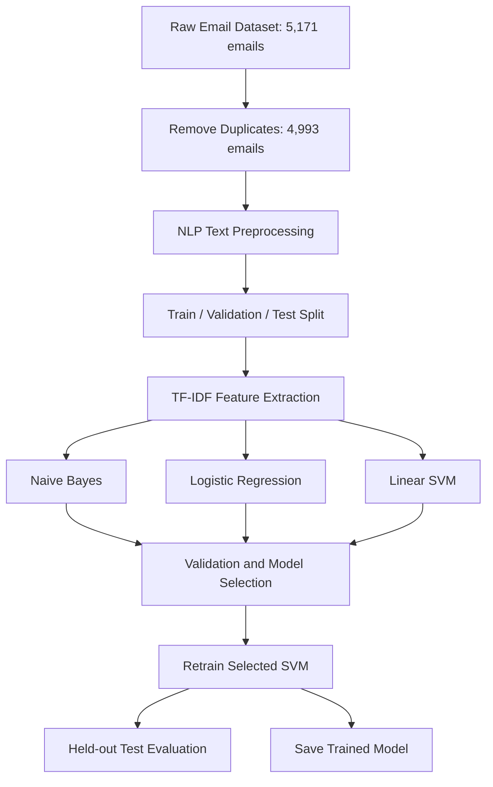
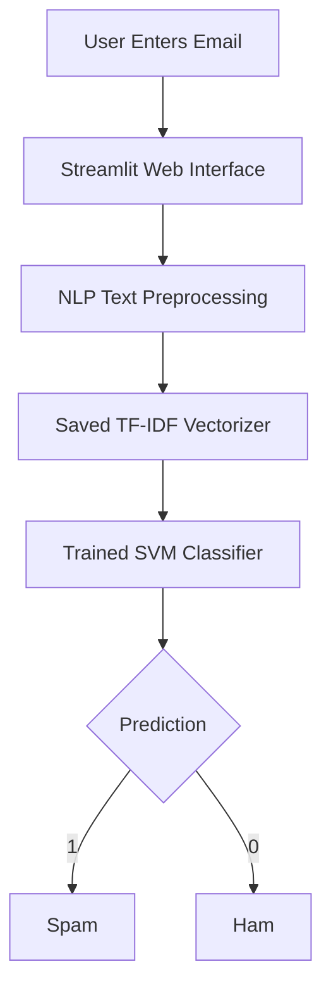

# MailGuard AI — System Architecture

## 1. Model Training Workflow

### Training Explanation

1. Load the labeled spam and ham dataset.
2. Remove duplicate email texts.
3. Perform NLP preprocessing.
4. Divide the dataset into training, validation, and testing sets.
5. Learn TF-IDF features from training data.
6. Train three classification algorithms.
7. Compare their validation performance.
8. Select and retrain the best-performing model.
9. Evaluate it using held-out test data.
10. Save the trained pipeline for future predictions.

## 2. Email Prediction Workflow

### Prediction Explanation

1. The user enters an email in the Streamlit interface.
2. The email is cleaned using the preprocessing function.
3. The saved TF-IDF vectorizer transforms the text.
4. The trained SVM model classifies the email.
5. Streamlit displays either SPAM or HAM.

The model is loaded from the saved pipeline.
It does not need to be retrained for each prediction.
